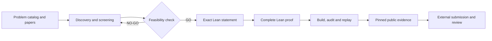
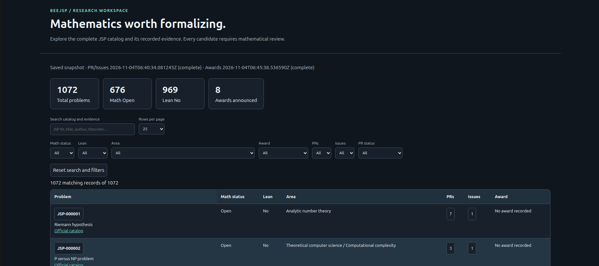

# BeeJSP

**Reproducible Lean formalization of mathematical results.**

BeeJSP is an open-source Python + Lean 4 project for selecting mathematical problems, formalizing their exact statements, and publishing machine-checkable proofs with reproducible evidence. It was initially built around the [Justin Sun Prize problem catalog](https://github.com/TheJustinSunPrize/awards), but the proof and verification workflow is independent of any prize.

> A Lean build checks the formal theorem. It does **not**, by itself, establish that the theorem faithfully represents the original mathematical problem.

## Completed formalizations

Both proof projects have passed BeeJSP's internal verification and have been submitted for external review. **Submission does not imply official acceptance or an award.**

| Problem                                                               | Principal Lean theorem                                                                                                                                                           | Proof merged into BeeJSP                                         | Justin Sun Prize submission                                              |
| --------------------------------------------------------------------- | -------------------------------------------------------------------------------------------------------------------------------------------------------------------------------- | ---------------------------------------------------------------- | ------------------------------------------------------------------------ |
| [JSP-000089 — Unavoidable cycle lengths](proofs/JSP-000089/README.md) | [`JSP000089.jsp_000089_complete`](https://github.com/beesyst/beejsp/blob/951f0d41114ad956bfe5485a0dad28cd34b3d7b7/proofs/JSP-000089/Principal.lean)                              | [PR #13](https://github.com/beesyst/beejsp/pull/13) · 2026-10-11 | [awards PR #5006](https://github.com/TheJustinSunPrize/awards/pull/5006) |
| [JSP-000334 — Newman's conjecture](proofs/JSP-000334/README.md)       | [`JSP000334.newman_conjecture_complete`](https://github.com/beesyst/beejsp/blob/e391232dc28003d7d9d7a26d6a12f93c71f41304/proofs/JSP-000334/SubspaceBridge/NewmanCompletion.lean) | [PR #26](https://github.com/beesyst/beejsp/pull/26) · 2026-11-02 | [awards PR #5527](https://github.com/TheJustinSunPrize/awards/pull/5527) |

_The dates above are internal proof-merge dates. Follow the linked awards PRs for their current external review status._

## What BeeJSP does

- **Discover:** normalize the JSP catalog; inspect problem status, publications, public PRs/issues, and recorded award evidence.
- **Select:** filter and rank candidates using source-backed research, competition state, and qualitative difficulty estimates. Missing difficulty or monetary information remains **unknown**, not guessed.
- **Formalize:** translate a mathematical result into an exact Lean statement and prove it with pinned Lean/Mathlib dependencies.
- **Verify:** check compilation, source-to-statement correspondence, proof dependencies, axioms, and reproducibility before publication.

## Workflow



The critical distinction is **statement fidelity versus kernel checking**: both are required, and external acceptance is a separate step.

## Discovery Dashboard

[**Explore Interactive Dashboard**](https://beesyst.github.io/beejsp/)



_Public read-only snapshot. Search, filter and explore the JSP problem catalog without installing BeeJSP. Data freshness is displayed in the dashboard._

The project includes a local, standalone HTML dashboard for exploring the problem bank. It supports search, sorting, and filters for mathematical status, Lean status, area, awards, PRs, issues, and PR lifecycle; detail views link to the underlying evidence. All captured data has timestamps and may become stale.

### Quick start

**Requirements:** Python 3.14+, [`uv`](https://docs.astral.sh/uv/), Git, Bash. Lean/Lake is additionally required to build proof projects.

```bash
git clone https://github.com/beesyst/beejsp.git
cd beejsp
uv sync

./start.sh update             # Refresh public evidence and generate the dashboard
./start.sh report             # Open the last saved report offline
./start.sh inspect JSP-000334 # Inspect one problem from saved evidence
```

The report is generated under Git-ignored `storage/discovery/`; no server or database is required. `update` uses GitHub's public API and may need a local `GITHUB_TOKEN` to avoid anonymous rate limits. See the [development guide](docs/DEV_GUIDE.md#iteration-7-local-discovery-dashboard).

## Reproduce a proof

Each formalization is a standalone Lean/Lake project with its own toolchain and dependency manifest. Start from its pinned source revision and follow its proof-specific README:

- [JSP-000089 — sources, build, theorem and axiom audit](proofs/JSP-000089/README.md)
- [JSP-000334 — sources, build and full verification suite](proofs/JSP-000334/README.md)

For example, from the repository root, the local JSP-000334 build and audit are:

```bash
cd proofs/JSP-000334
lake exe cache get
lake build
lake build SubspaceBridge.NewmanCompletion
lake env lean Audit.lean
# Optional full verification/replay suite (can take hours):
bash verify.sh
```

A complete formalization must have no `sorry`, `admit`, or custom unproved axiom replacing proof steps in the submitted theorem's dependency closure. Standard Lean axioms are explicitly audited. Source correspondence and independent external review remain separate from successful compilation.

## Documentation

| Document                               | Purpose                                              |
| -------------------------------------- | ---------------------------------------------------- |
| [ROADMAP](docs/ROADMAP.md)             | Completed milestones and future work                 |
| [ARCHITECTURE](docs/ARCHITECTURE.md)   | Boundaries, Python/Lean separation, evidence model   |
| [DEV_GUIDE](docs/DEV_GUIDE.md)         | Discovery CLI, profiles, tests and development setup |
| [FORMALIZATION](docs/FORMALIZATION.md) | Mathematical statement and verification contract     |
| [SUBMISSION](docs/SUBMISSION.md)       | External contribution and award-claim process        |
| [SECURITY](docs/SECURITY.md)           | Untrusted sources, dependencies and credentials      |

**Attribution:** BeeJSP credits original mathematical solvers separately from Lean formalizers and verifiers. AI-assisted development is not proof evidence; the authoritative artifacts are the source, the checked Lean theorem and reproducible verification results.

**Scope:** BeeJSP is a local research and proof workflow, not a hosted theorem-proving service or an automated award-claim system.
